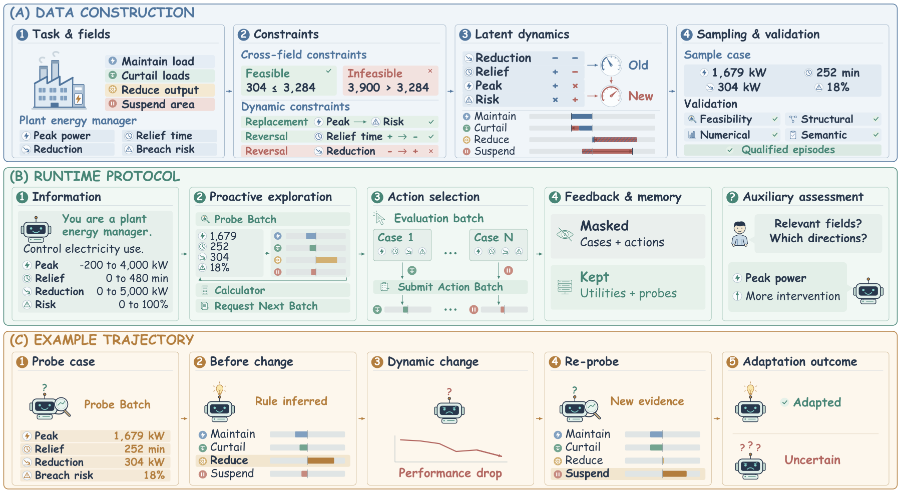
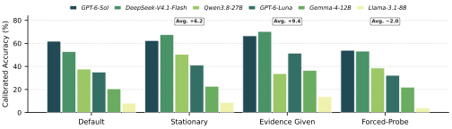
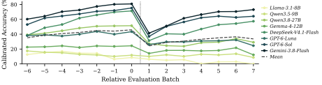

<div align="center">

# AdaExploreBench

### Evaluating Proactive and Adaptive Exploration in LLM Agents

**Design experiments. Discover hidden dynamics. Adapt when the environment changes.**

[](https://huggingface.co/datasets/Roryaccout/AdaExploreBench)
[](#-quick-start)
[](https://hkust-knowcomp.github.io/AdaExploreBench/)
[](https://github.com/HKUST-KnowComp/AdaExploreBench)

[Overview](#-overview) · [Quick Start](#-quick-start) · [Dataset](#-dataset) · [Evaluation](#-evaluation) · [Viewer](#-interactive-viewer)

</div>



This is the official repository for **AdaExploreBench**, a benchmark for evaluating whether LLM agents can **proactively explore unfamiliar environments and adapt to unannounced changes**. Agents design their own probes, infer hidden decision rules from utility feedback, and choose actions as the environment evolves.

## 🎯 Overview

Real decision environments require agents to decide **when to explore, what to test, and how to revise their understanding**. AdaExploreBench makes these abilities measurable through controlled operational tasks in **finance, healthcare, cybersecurity, and manufacturing**.

Each episode presents an operational role, numeric input fields, and four actions ordered by intervention strength. The agent knows the possible rule families, while the instantiated family, relevant factors, parameters, and change timing remain hidden. In the released dynamic episodes, an unannounced change replaces one relevant factor and reverses another factor's direction.

The interaction alternates between exploration windows and evaluation batches:

1. **Explore.** Design probe cases and observe utilities for all four actions, or proceed to the next batch.
2. **Act.** Select actions for the revealed evaluation cases and receive realized utility feedback.
3. **Adapt.** Use new evidence to revise the inferred rule when the environment changes.

By default, completed evaluation inputs and actions are removed from subsequent context, while utilities and self-collected probe observations are retained. Separate assessments measure factor and change recognition without entering the agent's later context.

## ✨ Core Features

- **Agent-directed exploration.** Agents choose their own experiments and control how much evidence to collect within each exploration window.
- **Controlled environmental changes.** Semantically grounded factor replacements and direction reversals test adaptation within the same rule family.
- **Diverse decision mechanisms.** Additive aggregation, conjunctive gating, disjunctive sufficiency, and lexicographic priority span four operational domains.
- **Diagnostic settings.** Stationary environments, retained evaluation evidence, required probing, and different change strengths isolate sources of difficulty.
- **Detailed evaluation.** Decision quality, probe use, factor recognition, and change recognition connect outcomes with exploration behavior.
- **Reproducible inspection.** Resumable runs, configuration snapshots, deterministic simulations, and an interactive overview support reproducible analysis.

## 🚀 Quick Start

### Installation

Use **Python 3.11+**. Run the following commands from the repository root:

```bash
git clone https://github.com/HKUST-KnowComp/AdaExploreBench.git
cd AdaExploreBench

python3 -m venv .venv
source .venv/bin/activate
python -m pip install -e '.[dev]'
```

The optional research viewer requires **Node.js 22.12+**, which satisfies the bundled Vite version:

```bash
npm --prefix viewer ci
```

### Configure a model

Model profiles live in [`configs/models/`](configs/models). Each profile selects its provider channel and defines generation settings, concurrency, timeouts, and retries. Set the credential and endpoint variables named by your chosen profile, either in your shell or a local `.env` file.

For example, [`deepseek-v4-flash.yaml`](configs/models/deepseek-v4-flash.yaml) reads:

```bash
export NUWA_API_KEY="your-api-key"
export NUWA_BASE_URL="https://your-provider-endpoint/v1"
```

Use the endpoint of a provider serving the model in the profile. For another provider, edit that profile's connection settings and use its corresponding credential variables. Runtime configurations select branches and interaction settings; the model profile is supplied separately.

### Download the test set

Download the release from [Hugging Face](https://huggingface.co/datasets/Roryaccout/AdaExploreBench):

```bash
python -m pip install -U huggingface_hub
hf download Roryaccout/AdaExploreBench \
  --repo-type dataset \
  --local-dir datasets/adaexplorebench
```

The available release contains the test split. The training split will be added when ready.

### Run one episode

```bash
python -u scripts/run_benchmark.py \
  --dataset datasets/adaexplorebench/data/test.jsonl \
  --run-config configs/runtime/default.yaml \
  --model-config configs/models/deepseek-v4-flash.yaml \
  --output-dir outputs/deepseek-v4-flash-high-default-test-256-20261015 \
  --max-cases 1
```

A new run requires all four explicit inputs and a new or empty output directory. Here, `--max-cases 1` limits the run to one episode. Omit `--max-cases` to evaluate all 256 test episodes.

Run directories use `<model>-<effort>-<runconfig>-<dataset>-<yyyymmdd>[-runN]`. The runner prints live `[progress]` updates and writes metrics, episode trajectories, a run manifest, and configuration snapshots beneath the output directory.

### Resume a run

```bash
python -u scripts/run_benchmark.py \
  --resume \
  --output-dir outputs/deepseek-v4-flash-high-default-test-256-20261015
```

Resume restores the recorded dataset and configuration snapshots. Explicit input arguments can override supported settings. A compatible runtime configuration may add branches while reusing completed trajectories and shared prefixes.

### Try the runtime without API credentials

```bash
python scripts/simulate_trajectory.py \
  --scenario valid_probe \
  --output-dir outputs/simulated-trajectory \
  --viewer-output viewer/public/data-simulated \
  --gzip
```

The simulator uses scripted model responses against the real runtime and produces artifacts that can be opened in the viewer.

## 📦 Dataset

AdaExploreBench contains a **256-episode test set**, balanced across four domains and four rule families. A **1,024-episode training set** is in preparation. Dataset files are distributed through [Hugging Face](https://huggingface.co/datasets/Roryaccout/AdaExploreBench).

| Split | Episodes | Status |
| :--- | ---: | :--- |
| `test` | 256 | Available on Hugging Face |
| `train` | 1,024 planned | In preparation |

Each dynamic episode exposes eight numeric fields, with three active factors in each phase, and four available actions.

| Rule family | Decision mechanism |
| :--- | :--- |
| Additive aggregation | Combine weighted contributions from relevant factors |
| Conjunctive gating | Require all relevant conditions to support intervention |
| Disjunctive sufficiency | Allow any sufficient condition to support intervention |
| Lexicographic priority | Evaluate factors according to a priority order |

The Hugging Face release includes a manifest recording its schema, composition, and integrity information. Episode files contain hidden mechanisms and oracle annotations for the evaluator; the runtime constructs the agent-visible task and feedback.

## 📊 Evaluation

| Metric | What it measures |
| :--- | :--- |
| **Exact Accuracy (EA)** | Fraction of evaluation cases assigned an optimal action |
| **Calibrated Accuracy (CA)** | Utility-sensitive decision quality, calibrated so a uniformly random policy scores zero in expectation and an optimal policy scores one |
| **Mean Unique Probes** | Distinct probe cases queried, with uniqueness counted separately before and after a change |
| **Mean Re-probes after Change** | Distinct pre-change probe points queried again after the change |
| **Factor Recognition** | F1 for identifying the relevant factors through auxiliary assessments |
| **Change Recognition** | Set F1 for identifying atomic changes inferred from the assessments |

Runtime configurations are in [`configs/runtime/`](configs/runtime). [`default.yaml`](configs/runtime/default.yaml) runs the standard `flip_50` setting. [`full.yaml`](configs/runtime/full.yaml) adds diagnostic branches. Branch definitions specify sampling, rule changes, evaluation history, and probe requirements.

### Analysis across settings



The diagnostic settings examine how performance depends on environmental changes, access to evaluation evidence, and required exploration. [View PDF](figures/analysis.pdf).

### Adaptation trajectories



Episode-level curves support closer analysis of performance around environmental changes. [View PDF](figures/error_analysis_ca_curve.pdf).

## 🔎 Interactive Viewer

The [live overview](https://hkust-knowcomp.github.io/AdaExploreBench/) compares **eight models across all 256 benchmark episodes**. It presents decision quality, exploration behavior, factor recognition, change recognition, and diagnostic settings. The publication contains aggregate results in a single compressed file.

```bash
VITE_COMPRESSED_DATA=true npm --prefix viewer run dev
```

Open the local URL printed by Vite, normally `http://127.0.0.1:8000`.

Researchers can generate local viewer data from their own completed runs:

```bash
python -u viewer/generate_data.py \
  --dataset datasets/adaexplorebench/data/test.jsonl \
  --run-dir outputs/your-completed-run \
  --replace \
  --gzip

python viewer/validate_public_data.py \
  --data-dir viewer/public/data \
  --compressed
```

`--replace` rebuilds the viewer publication from the listed runs. Repeat `--run-dir` to compare models, or use `--append` to add runs to an existing publication. See the [viewer guide](viewer/README.md) for local publication tooling and summary caching.

## 🛠️ Dataset Construction

The synthesis pipeline builds scenario templates, validates rule mechanisms and feasible cases, reviews semantic quality, and writes datasets with manifests. API-backed generation requires the credentials selected by the synthesis model profiles.

To construct new datasets, first generate and publish a canonical template release with the synthesis pipeline. Its output paths are configured in `configs/synthesis/templates.yaml`. You can check the configuration and any locally generated release with:

```bash
python scripts/synthesize.py templates \
  --config configs/synthesis/templates.yaml \
  --check
```

Generate a dynamic dataset in the location configured by the YAML:

```bash
python -u scripts/synthesize.py dataset \
  --config configs/synthesis/dynamic.yaml \
  --run-id dynamic-release-001 \
  --operation fresh
```

Inspect the configured output paths before generation. Use a new run ID for a fresh generation and `--resume` to continue an interrupted run. Static dataset synthesis is available through [`configs/synthesis/static.yaml`](configs/synthesis/static.yaml).

## 🗂️ Repository Structure

```text
AdaExploreBench/
├── configs/           # Model profiles, runtime branches, and synthesis settings
├── figures/           # Benchmark overview and analysis figures in PNG and PDF
├── generator/         # Provider clients and conversation adapters
├── prompts/           # Runtime and synthesis prompt templates
├── scripts/           # Benchmark, synthesis, simulation, and reporting CLIs
├── src/
│   ├── protocol/      # Shared mechanisms, constraints, and provenance
│   ├── runtime/       # Environments, interaction, execution, resume, and metrics
│   └── synthesis/     # Template and dataset construction pipelines
├── tests/             # Runtime, synthesis, and provider regression coverage
└── viewer/            # Interactive dashboard and publication tooling
```

## 🧪 Development

Run focused tests for the behavior you change, for example:

```bash
python -m pytest -q tests/runtime/test_conversation.py
npm --prefix viewer run test -- src/OverviewApp.test.tsx
```

Before deploying the viewer, validate its publication and build the production bundle:

```bash
python viewer/validate_public_data.py --compressed
VITE_COMPRESSED_DATA=true npm --prefix viewer run build
```

## 🤝 Contributing

Issues and pull requests are welcome for bug fixes, model integrations, and benchmark extensions. Include the affected configuration and a reproducible example when reporting a problem.
